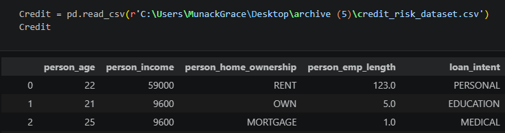

# Credit Risk & Portfolio Performance Analytics

---

## Overview

This project presents a comprehensive evaluation of retail loan default risk, borrower credit profiles, and portfolio performance metrics based on an analysis of **32,581 loan records**. The primary objective of this project is to identify primary risk drivers, evaluate current underwriting and risk-based pricing efficiency, and outline strategic recommendations to mitigate default exposure while optimizing loan portfolio yield.

---

## Technology Used

* **Programming Language:** Python
* **Data Manipulation & Analysis:** Pandas, NumPy
* **Data Visualization:** Matplotlib, Seaborn, Tableau.

Python Script

---

## Project Workflows

1. **Data Collection & Ingestion:** Loaded the raw credit risk dataset into Pandas and performed initial structural inspections (`credit.columns`, `head()`).
2. **Data Cleaning & Handling:** Inspected missing values, standardized column names, and prepared data types for downstream manipulation.
3. **Feature Engineering:** 
   * Created custom age group brackets (**Teenager**, **Young Adult**, **Middle-Aged**, **Senior**).
   * Binned loan amounts relative to income into distinct tiers (`< 10%`, `10% - 20%`, `20% - 30%`, `> 30%`).
4. **Exploratory Data Analysis (EDA):** Aggregated metrics using SQL and Pandas to evaluate default probabilities across loan purposes, risk grades, income burdens, and homeownership statuses.
5. **Dashboard Development:** Designed a multi-quadrant executive dashboard in Tableau incorporating interactive filters for age groups, loan grades, and default status labels.

---

## Key Insights

* **Prior Bureau Defaults:** Borrowers with a prior default on record default at **37.81%**, compared to **18.39%** for clean credit files.
* **Critical Debt Burden Tipping Point:** When loan amounts exceed **30% of annual income**, the default rate spikes dramatically to **70.32%**.
* **Loan Purpose Risk Ranking:** **Debt Consolidation** and **Medical** loans pose the highest portfolio risk with default rates of **28.59%** and **26.70%** respectively.
* **Credit Rating Calibration:** Risk grades show severe deterioration in higher tiers, culminating in a **98.44% default rate** for Grade G loans—where interest pricing fails to cover expected losses.
* **Homeownership Impact:** **Renters** present a **31.57% default rate**, whereas outright homeowners exhibit superior repayment discipline with a **7.47% default rate**.

---

## Recommendations

1. **Enforce Hard Debt Caps:** Implement a strict underwriting cap at **25%–30% loan-to-income** to eliminate the segment responsible for a 70.32% default rate.
2. **Restructure High-Risk Grades:** Discontinue automated approvals for **Grades E, F, and G** due to catastrophic default exposure (up to 98.44%).
3. **Refine Pricing for Defaulters:** Introduce stricter debt-to-income criteria and mandatory co-signers for applicants with prior bureau default history.
4. **Targeted Policy by Purpose:** Require direct creditor disbursement for **Debt Consolidation** loans to prevent stacked debt accumulation.
5. **Incorporate Housing Status in Models:** Enhance liquidity verification requirements for **Renters** due to their elevated default frequency.
